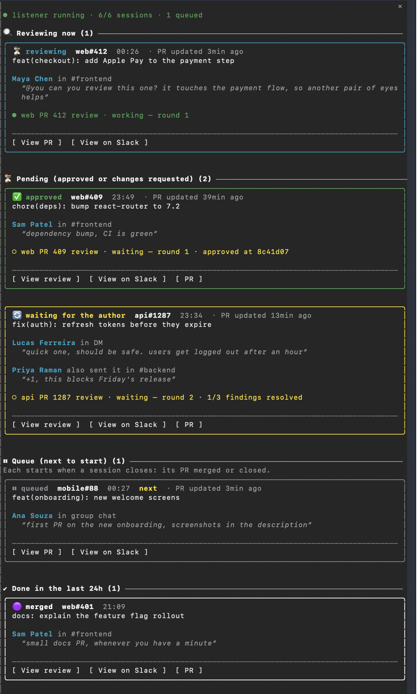
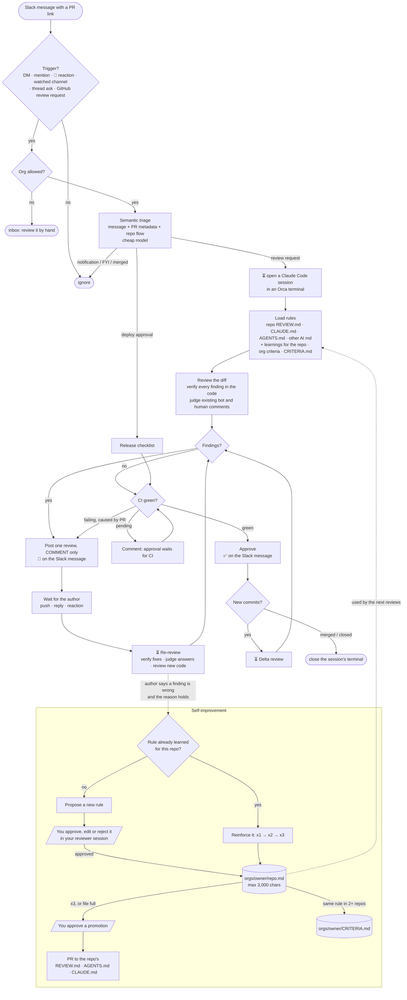

# agentic-reviewer

<p align="center">
  
</p>

**Become an agentic code reviewer.** Teammates ask you for a review the way they always do, by dropping a PR link in Slack. A Claude Code session picks it up, reviews the PR against the repository's own rules and your criteria, posts the comments, follows up with the author, and approves once everything is resolved. Each step shows up as a reaction on the Slack message.

You stay the reviewer: reviews and approvals go out under your own GitHub and Slack accounts, and are marked as AI-generated. The agent does the work, while what counts as a good change comes from the repository's rules and the criteria you set.

> Status: private preview. [Orca](https://orca.build) + [slackcli](https://github.com/shaharia-lab/slackcli) + [Claude Code](https://claude.com/claude-code).

<p align="center">
  <a href="https://www.youtube.com/watch?v=p950JfvPfKk">
    
  </a>
  <br>
  <sub>▶ <a href="https://www.youtube.com/watch?v=p950JfvPfKk">Watch the 1:44 explainer on YouTube</a></sub>
</p>

## What it looks like

> **#team-reviews** — **Alex**: hey @you, can you take a look? https://github.com/acme/web/pull/42

1. Within seconds the message gets ⏳: a Claude Code session opened for that PR in an Orca terminal and is reviewing it.
2. The review lands on GitHub as inline comments: a bug with a concrete scenario, a rule from the repo's `REVIEW.md` or `CLAUDE.md` that the change breaks, a missing test. Comments from review bots and other reviewers already on the PR are judged too: the ones the agent agrees with get 👍 and are tracked, and a bot finding it disagrees with gets a reply explaining why.
3. The reaction flips to 🔄: there is something for Alex to fix.
4. Alex pushes a fix and replies in a thread. The agent wakes up, flips back to ⏳, and verifies each fix in the code. A reply saying "Fixed" is not enough. It resolves the threads that are done and pushes back once, with a concrete scenario, on an answer that does not hold.
5. Everything resolved and CI green: the agent approves, and the reaction becomes ✅.
6. If new commits land after the approval, it reviews just the delta and re-approves when it is clean. When the PR is merged or closed, the session closes its own terminal.

When the listener starts, it goes through the review sessions still open in Orca. A session whose PR was merged or closed while it was down gets its terminal closed. The others are told to relaunch their background wait, which a Mac or Orca restart kills, so they pick up where they stopped.

The same PR often arrives twice: a review request on GitHub and a link in Slack. A Slack message for a PR that is already handled (a session open, already reviewed, approved or merged) does not open a second session, but it still gets the PR's current status as a reaction and follows it from there.

A message like *"merged #42, thanks!"* or *"deploy PR is up: staging → main, need an approval"* is triaged before any session opens. The first one is a notification, so nothing happens. The second gets a **release checklist** instead of a line-by-line review: only already-reviewed changes are going in, CI is green, migrations and feature flags are accounted for. Then it approves, or flags what is off.

### Hold: quiet PRs make room for the queue

Only `max_sessions` reviews run at once, and a PR that is approved or waiting for the author can sit for hours keeping its session. When every session is busy and PRs are waiting in the queue, the listener puts the quietest ones on hold, as many as the queue needs: an approved PR with no activity for 30 minutes, or one waiting for the author for an hour (both counted from the PR's last update on GitHub, the agent's own comments included). It closes the session's terminal, and the next PR in the queue takes the slot. A session that is waiting for CI to approve is never held, and with free sessions or an empty queue nothing is held at all.

A PR on hold costs no tokens. Every 30 minutes the listener checks it with plain GitHub calls: a new commit, a human comment or review, or a new review request from the author sends it back to the front of the queue. The new session finds the loop's state file and picks up where the old one stopped. A PR merged or closed while on hold just leaves it. The limits are in `reviewer.yaml` under `review.hold`.

### The PR panel

The plugin ships a Claude Code [mod](https://code.claude.com/docs/en/plugins/mods/overview): a pane beside the chat that opens with `/agentic-reviewer:start` (or any time with `/reviewer-panel`) and refreshes every 10 seconds. It splits the PRs into what is being reviewed now, what is pending (approved, or waiting for the author), the queue of reviews waiting for a free session, the PRs on hold with their next check, and what was finished in the last 24 hours. Each card shows who sent the PR on Slack, their message and where they sent it, anyone else who sent the same PR, what the review agent is doing (working or waiting, the round, how many findings are resolved), when the PR last changed on GitHub, and links to the review, the Slack message and the PR. The pane follows `language` in `reviewer.yaml` (English or Portuguese).

<p align="center">
  
</p>

## The flow



## How it works

You open Claude Code in your reviewer folder (where `reviewer.yaml` and `CRITERIA.md` live), run `/agentic-reviewer:start`, and leave that session open. That session is the switch: while it is open, the listener runs in its background and every PR handed to you opens its own review terminal in Orca. Close the session, or run `/agentic-reviewer:stop`, and nothing listens anymore. Nothing is installed in the system and nothing starts with the Mac.

| Piece | What it does |
| --- | --- |
| **Listener** (`listener/`) | A background process of your Claude Code session, started by `/agentic-reviewer:start`. It runs while that session is open and stops with it. It listens to Slack in real time over the websocket of your own browser session (read from `slackcli`'s keychain entry), catches up with Slack search after every reconnect and every 10 minutes, filters by trigger and org, runs the semantic triage, and opens one Orca terminal per PR, up to `max_sessions` at once (the rest wait in a queue). It closes the terminal when the PR leaves `OPEN`. State and logs live in `~/.agentic-reviewer/`. |
| **Triage** | A cheap model (`claude -p` on Haiku) reads the message, the PR's metadata (title, base and head branches, state, labels, files) and the repository's flow (`REVIEW.md`, `CLAUDE.md`, `AGENTS.md`, `CONTRIBUTING`, release docs), and answers `review_request`, `deploy_approval`, `notification` or `other`. Only the first two open a session. |
| **`/agentic-reviewer:review`** | The review loop, one session per PR: rules first and taste last, findings verified in the code, one review per round, never `REQUEST_CHANGES`, never merges. It waits for the author in the background, re-reviews, approves, keeps the approval honest on new commits, and drives the Slack reactions. With `mode=deploy` it runs the release checklist instead. |
| **PR panel** (`hooks/`) | The mod behind the pane above. It only reads what the listener and the review sessions already write in `~/.agentic-reviewer/`, plus `orca terminal list`, `gh` for each open PR's last update, and `slackcli` for channel names. It polls only in a session where the pane was opened, so review sessions cost nothing. |
| **`learnings`** | Goes through the rules review sessions proposed, promotes the ones that keep coming back into the repository (as a PR), and keeps each learnings file under its limit. |
| **`setup` · `start` · `stop` · `status` · `open`** | `/agentic-reviewer:setup` interviews you once, writes `reviewer.yaml` and `CRITERIA.md`, and checks `slackcli`, `gh`, Orca and `uv`. `start` launches the listener in the background of the current session and turns that conversation into a live panel of every PR it found and reviewed (status, who sent it on Slack and what they wrote, the message's current reaction, PR and Slack links, approval or findings link); `stop` ends it; `status` shows open reviews, the queue, recent decisions and the inbox; `open <slack link>` reviews a message the listener did not pick up. |

### Triggers

| Trigger | Fires when |
| --- | --- |
| Direct message | someone sends you a PR link in a DM |
| Mention | a channel or group message with a PR link mentions you |
| Watched channel | a PR link is posted in a channel listed in `reviewer.yaml`, whether or not you are mentioned (the triage decides) |
| Thread ask | someone mentions you in the thread of a message that has a PR link |
| 👀 reaction | **you** react with :eyes: to any message that has a PR link, in any channel |
| Manual | `/agentic-reviewer:open <slack message link>` |
| GitHub review request | you are **personally** in the PR's requested reviewers. A request to a team, a group or CODEOWNERS does not count |

Your own messages never trigger a review, and neither do PRs you authored, PRs that are not open, or PRs whose current head you already approved. When the review status goes on the message (⏳ → 🔄 / ✅), your 👀 is removed, so the message only shows the current status.

### Where the review criteria come from

Highest priority first:

1. **The PR's repository**: every AI and contributor instruction file it has, at the root and in each directory the PR touches. That means `REVIEW.md`, `CLAUDE.md` (and `.claude/CLAUDE.md`), `AGENTS.md`, `GEMINI.md`, `.github/copilot-instructions.md`, `.cursor/rules/` or `.cursorrules`, `CONTRIBUTING.md` and the PR template, plus the docs those files point to for the code the PR touches. `REVIEW.md` comes first when it exists, because it is written for reviewers. A pattern the repo endorses is never a finding.
2. **What the reviewer learned in that repository** (`orgs/<owner>/<repo>.md`, see Self-improvement).
3. **Your criteria for that org** (`orgs/<owner>/CRITERIA.md`), including your own account for personal repositories.
4. **Your general criteria** (`CRITERIA.md`), in plain text. For example: "flag any new endpoint without an authorization test", or "we prefer integration tests over unit tests".
5. **Your global Claude Code instructions** (`~/.claude/CLAUDE.md`).

### Self-improvement

The reviewer learns each repository from the people who work in it. When an author answers a finding on GitHub with a reason that holds ("this is intended, here we read flags through `useFlag`"), in a review thread or a PR comment, the review session turns it into one short rule for that repository:

- **New rule** → proposed to you. Your reviewer session (the one that ran `/agentic-reviewer:start`) wakes up and asks you to approve, edit or reject it. Answering never pauses anything: the listener and the review sessions keep working in their own processes, and an unapproved rule is simply not used yet.
- **A rule that comes back** → reinforced on its own (`[x1]` → `[x2]` → `[x3]`), with the PRs as sources.
- **Three times, or the file is full** → you are asked to promote it into the repository's own `REVIEW.md`, `AGENTS.md` or `CLAUDE.md`, so every reviewer and agent on the team gets it. On approval the reviewer opens that PR for you, and the rule leaves your file once it is merged.
- **The same rule in two or more repos of an org** → proposed for that org's criteria, where it applies to all of its repositories.

Learnings live in your reviewer folder, one folder per org and one file per repository, each capped at 3,000 characters (`learning.max_chars`), so work and personal projects stay apart and no project crowds out another:

```
CRITERIA.md                   your criteria, every org
orgs/acme/CRITERIA.md         criteria for the acme org
orgs/acme/web.md              what the reviewer learned in acme/web
orgs/your-login/CRITERIA.md   criteria for your personal repositories
pending-learnings.jsonl       proposals waiting for you
```

Run `/agentic-reviewer:learnings` any time to go through what is pending, promote rules, or tidy a file that is getting full.

### Configuration

`reviewer.yaml`, the criteria and the learnings are personal: they live in your reviewer folder and stay out of git (this repo's `.gitignore` already lists them, so you can use your clone as the reviewer folder). Start from [`reviewer.example.yaml`](reviewer.example.yaml) and [`CRITERIA.example.md`](CRITERIA.example.md), or let `/agentic-reviewer:setup` write them:

```yaml
slack:
  watch_channels: [team-reviews, deploys]  # every PR link here is a candidate; the triage decides
  trigger_reactions: [eyes]
github:
  allowed_orgs: [acme]            # required: PRs from other orgs go to the inbox, never auto-reviewed
  review_requests: true           # only when you are personally requested
  clones_dir: ~/code              # <clones_dir>/<repo>, so the review reads whole files
review:
  model: claude-opus-5-5
  effort: medium
  max_sessions: 4
triage:
  model: claude-haiku-5-5
orca:
  worktree: ~/orca/workspaces/reviews/main   # required: where the review terminals open
learning:
  max_chars: 3000                 # per repository learnings file
  promote_after: 3                # times a rule comes back before it is proposed for the repo
inbox: ~/.agentic-reviewer/inbox  # things that need you: expired Slack session, Orca down, a PR from another org
```

On the first start nothing old is replayed: Slack is read from that moment on, and GitHub review requests already pending are skipped.

## Safety

- **Allowed orgs only.** Each review session runs Claude Code without permission prompts and reads the PR repository's instruction files. Anyone who can DM you, including external people in Slack Connect, can send a link. So only PRs from `allowed_orgs` open a session; anything else lands in the inbox for you to decide.
- **Only the extracted URL** goes into the review session's prompt, never the Slack message text. The triage does read the message, so it runs with no tools, no settings, no MCP servers and no session history, and it can only answer one of four labels.
- **The agent never** merges, pushes, edits the author's code, uses `REQUEST_CHANGES`, or dismisses someone else's review. It does not approve while a critical or security finding is open, while a check the PR caused is failing, or on a head commit it has not reviewed.
- **Credentials stay in the keychain.** The Slack session is read at connect time and never written to disk or logs.
- **The Slack connection is unofficial.** It uses your browser session (`xoxc` token and `d` cookie) the way the Slack web client does. Slack can change the protocol without notice, and logging out of Slack in the browser ends the session. The listener reports that to the inbox.

## Requirements

- [Orca](https://orca.build): each review runs in its own Orca terminal
- [Claude Code](https://claude.com/claude-code)
- [slackcli](https://github.com/shaharia-lab/slackcli), logged in with `slackcli auth login-auto`
- [GitHub CLI](https://cli.github.com), logged in as the reviewer
- [uv](https://docs.astral.sh/uv/): setup installs it when it is missing

## Install

**Option 1 — clone the repository (recommended).** The clone becomes your reviewer folder: your `reviewer.yaml`,
criteria and learnings live next to the plugin and stay out of git (`.gitignore` already lists them), and the same
folder is the Orca worktree the review terminals open in.

```bash
git clone https://github.com/BrOrlandi/agentic-reviewer.git
cd agentic-reviewer
claude
```

Then, in Claude Code:

```bash
/plugin marketplace add ./
/plugin install agentic-reviewer@agentic-reviewer
/agentic-reviewer:setup      # once: interview → reviewer.yaml, CRITERIA.md
/agentic-reviewer:start      # each time: listen while this session is open
```

To update: `git pull`, then `/plugin marketplace update agentic-reviewer`.

**Option 2 — install the plugin only.** Setup saves your configuration in the folder where you run it, so pick a
folder you will keep (for example `~/agentic-reviewer`) and always start from there.

```bash
/plugin marketplace add BrOrlandi/agentic-reviewer
/plugin install agentic-reviewer@agentic-reviewer
/agentic-reviewer:setup
/agentic-reviewer:start
```

To try the triage on a message without opening anything:

```bash
uv run --script listener/listener.py triage --config reviewer.yaml <slack message link>
```

## Limitations

- **Orca only.** Every review runs in an Orca terminal.
- **Reactions made while the listener is off are not recovered** (Slack search does not find reactions). Remove the 👀 and add it again.
- **Thread asks are seen live only.** A mention in a thread while the listener is off is not caught up; use `/agentic-reviewer:open` with the parent message.
- **The Slack connection is unofficial** (see Safety).

## License

MIT

---

**Liked this skill?** See more of my Claude Code skills in [**my-claude-skills**](https://github.com/BrOrlandi/my-claude-skills): commits, pull requests, PR review, releases, Jira, Slack, hooks and a statusline.
